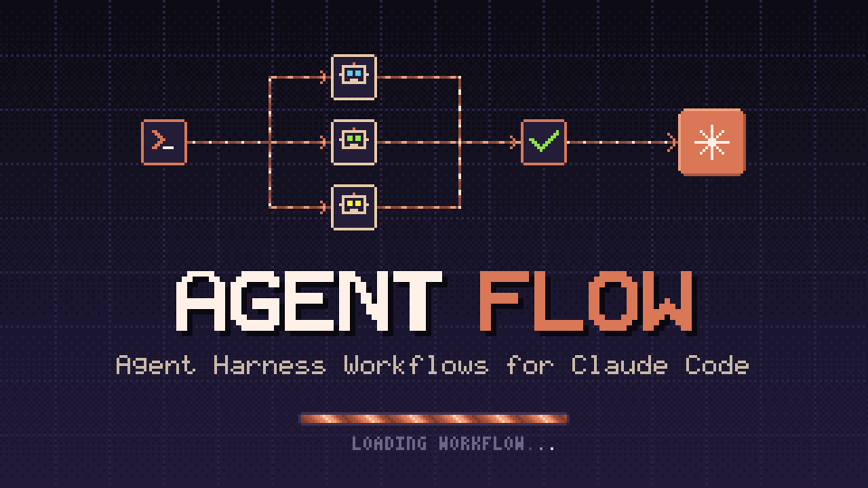
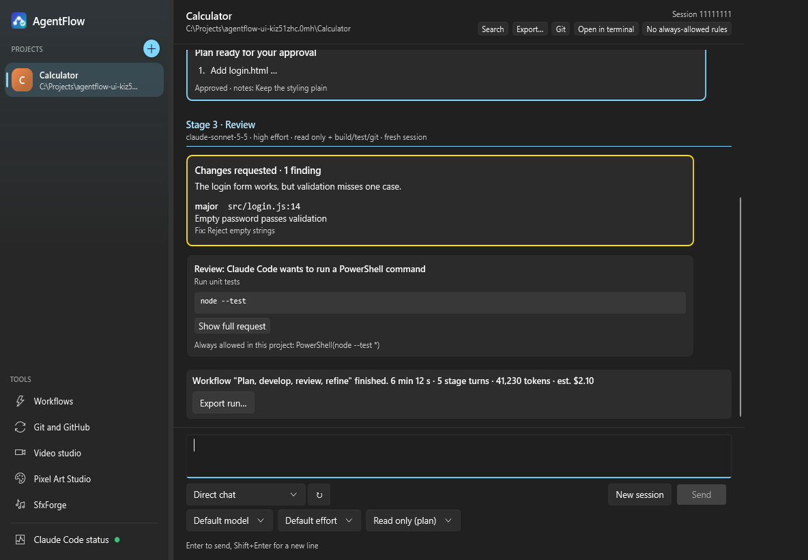
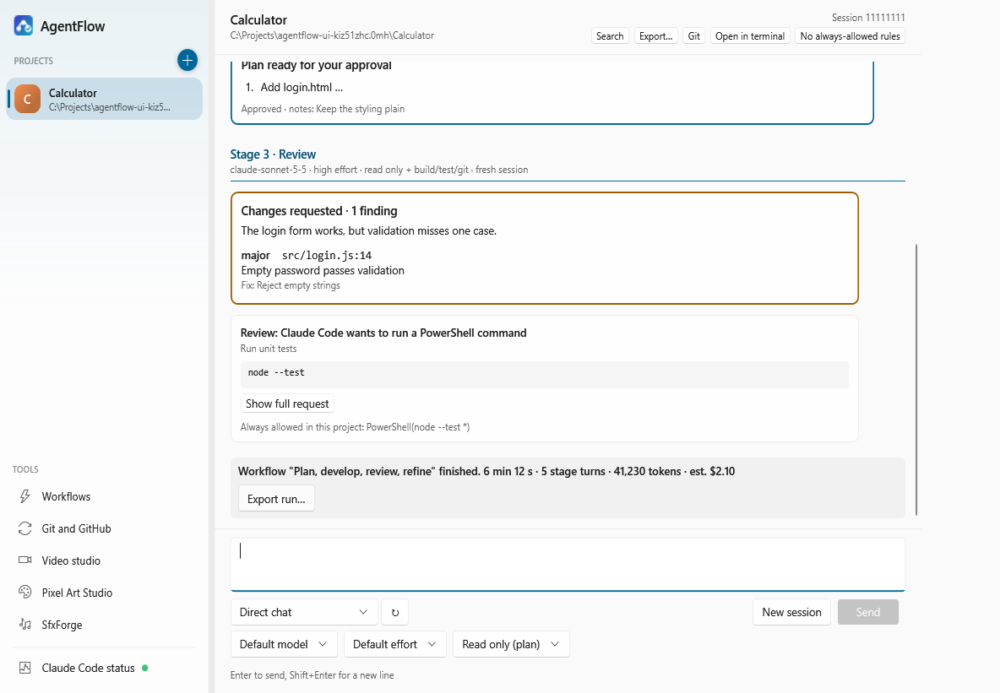
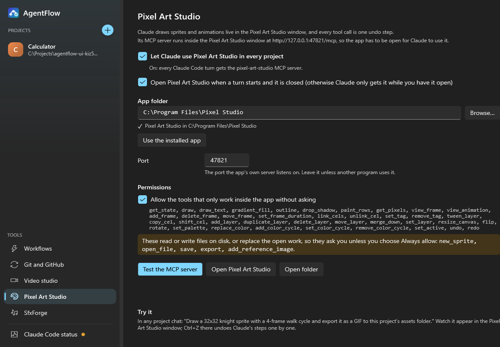
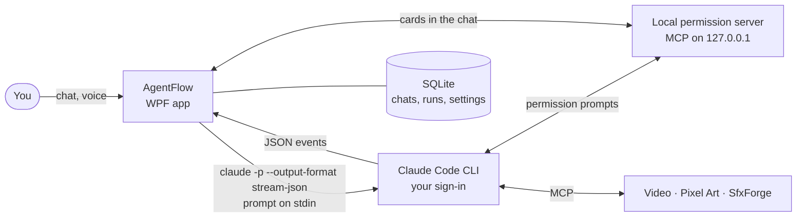

<div align="center">



# AgentFlow

**A Windows desktop app for Claude Code: chats, multi-agent workflows, voice, and creative studios, all in one window.**

Plan with one model, build with another, have a third review it, and approve every step from a chat.<br>
AgentFlow drives the official `claude` CLI you already have installed. Your account and sign-in stay with Claude Code.

[](LICENSE)
[](#-get-started)
[](https://dotnet.microsoft.com/)
[](#-a-ui-that-feels-alive)
[](https://docs.claude.com/en/docs/claude-code/overview)

[Features](#-features) · [Screenshots](#-screenshots) · [Get started](#-get-started) · [How it works](#-how-it-works) · [Full guide](docs/GUIDE.md)

</div>

---

## ✨ Why AgentFlow?

Claude Code is brilliant in a terminal. AgentFlow wraps it in an app with a few extras:

- **Run a whole pipeline from one message.** *Plan → Develop → Review → Refine*, each stage with its own model, effort and permissions, and a gate where you approve the plan.
- **Answer permission prompts in the chat.** When Claude wants to run a command, you get a card with **Allow once**, **Always allow** or **Deny**.
- **Talk to it, and hear it reply.** Push-to-talk speech recognition and natural text to speech, both running on your own PC.
- **Give Claude creative tools.** Video, pixel-art and sound-effect studios are added as MCP servers, so you can say "draw a sprite and make a jump sound for it".

> **No bypass mode.** AgentFlow never uses `bypassPermissions`, never calls Anthropic's API directly, and never reads, stores or asks for your credentials.
> Every turn is one ordinary `claude -p` process, run the way the CLI is documented to run.

## 🚀 Features

<table>
<tr>
<td width="50%" valign="top">

### 🧭 Multi-stage workflows
- A built-in **Plan → Develop → Review → Refine** pipeline
- Per-stage **model, effort, permissions and session**
- **Approval gate** on the plan: approve, edit, add notes, or ask for changes
- The reviewer returns a **structured verdict**, and requested changes loop back to Refine automatically
- **Retry, skip, or run again from any stage**, and resume after a crash
- A visual **workflow builder** with drag-to-reorder stages, live validation and prompt variables

</td>
<td width="50%" valign="top">

### 💬 Project chats
- One persistent Claude Code **session per project**: close the app and pick up where you left off
- **Streaming replies** in Markdown, with tool calls and results
- **Queue** messages while Claude is still working
- **Search** (Ctrl+F), **export to Markdown**, and **open the session in the terminal**
- Token and **cost estimates** per stage and per run

</td>
</tr>
<tr>
<td valign="top">

### 🛡️ Approvals in the chat
- Claude Code's permission prompts arrive as **cards in the chat**
- **Always allow** saves a scoped rule such as `PowerShell(node --test *)`
- Optional unattended mode for workflow runs, which still respects every deny rule and read-only stage
- Tools that cost money **always ask**

</td>
<td valign="top">

### 🎙️ Voice in and out, on your PC
- **Push-to-talk** (Right Ctrl) with NVIDIA **Parakeet** speech recognition, which corrects the text live as you speak
- Learns your project's file, class and function names, so "video studio view model" becomes `VideoStudioViewModel`
- Replies read aloud with **Kokoro-82M**, sentence by sentence while they stream
- Runs on the GPU with **DirectML** (AMD, Intel or NVIDIA) or on the CPU. **No audio leaves your PC.**

</td>
</tr>
<tr>
<td valign="top">

### 🎨 Creative studios (MCP)
- 🎬 **Video studio**: narrated videos with music, sound effects and openly licensed stock media
- 🖌️ **Pixel Art Studio**: Claude draws live on the canvas, and every action is one undo step
- 🔊 **SfxForge**: 8-bit sound design, playback and `.wav` export
- Started on demand, with a permission list for each tool

</td>
<td valign="top">

### 🌿 Git and GitHub built in
- A guided setup checklist: Git, your identity, and a browser sign-in through **Git Credential Manager**
- **Init, commit, push and pull** from the app, with clear recovery when histories have diverged
- Network-drive friendly: `safe.directory` is only added after you confirm

</td>
</tr>
</table>

### 🫧 A UI that feels alive
WPF **Fluent** theming that follows Windows light and dark mode, a **jelly-bounce** sidebar with spring animations, an animated pixel-art splash, and synthesized notification sounds (FM bells and marimba, generated in code; nothing is downloaded). All motion turns off when Windows' *Show animations* setting is off.

## 📸 Screenshots

<div align="center">



<sub>A <b>Plan → Develop → Review → Refine</b> run: the approved plan, a structured review finding, and a permission prompt answered in the chat.</sub>

<br><br>

 

<sub>Light mode, which follows your Windows theme, and the Pixel Art Studio page, where Claude gets 43 drawing tools with a permission list for each.</sub>

</div>

## ⚡ Get started

### What you need
- **Windows 10 or 11** (x64)
- **[Claude Code](https://docs.claude.com/en/docs/claude-code/overview)** installed and signed in with your own account:
  ```powershell
  claude auth login
  ```
- To build from source: the **[.NET 10 SDK](https://dotnet.microsoft.com/download)**

### Run from source
```powershell
git clone https://github.com/djgene01/AgentFlow.git
cd AgentFlow
dotnet run --project src/AgentFlow.App
```

Then click **+**, pick a project folder, choose a model and permission mode, and start chatting. Pick **Plan, develop, review, refine** in the composer to run the full pipeline.

### Build the installer
```powershell
.\build-installer.ps1
```
This produces `artifacts\AgentFlow-<version>-x64.msi`: a self-contained per-machine install (no .NET needed on the target PC), with Start menu and Desktop shortcuts and in-place upgrades. See the [guide](docs/GUIDE.md#build-the-installer) for how to bundle the optional studios.

## 🔧 How it works



- **One process per turn.** Each message starts `claude -p --output-format stream-json`; the prompt goes in on stdin and events stream back as JSON lines. Sessions resume with `--resume`.
- **Approvals.** A small MCP server on `127.0.0.1` (random port, a fresh secret per turn) is passed as `--permission-prompt-tool`, so Claude Code's own permission checks come to you as chat cards.
- **Clean stops.** **Stop** sends a real Ctrl+C to that one CLI process through a Job Object, so the session can still be resumed afterwards.
- **Local storage.** Chats, raw CLI events and settings are kept in SQLite under `%LOCALAPPDATA%\AgentFlow`. Prompts and answers are never written to the logs.

### Project layout

| Project | What's inside |
| --- | --- |
| `src/AgentFlow.Core` | Agent contracts, project chats, the workflow engine, approvals, Git, MCP integrations |
| `src/AgentFlow.ClaudeCli` | CLI locator, argument builder, process runner, stream-json parser |
| `src/AgentFlow.Permissions` | The local MCP permission server |
| `src/AgentFlow.Speech` | Parakeet speech to text, Kokoro text to speech, spoken-text clean-up |
| `src/AgentFlow.Storage` | SQLite store |
| `src/AgentFlow.App` | The WPF app |
| `tests/` | xUnit tests, plus `FakeClaude`, which replays recorded CLI sessions |

```powershell
dotnet test
```

## 🗺️ Ideas and contributions

Issues and pull requests are welcome. Some directions that would be fun:
- More built-in workflow templates, such as test-first, refactor or docs pass
- More MCP studio integrations
- Localisation (the UI is English only for now)

Please keep changes in line with how AgentFlow works: it runs the official CLI as documented, never uses a bypass mode, and never handles credentials.

## 🙏 Credits

- [Claude Code](https://docs.claude.com/en/docs/claude-code/overview) by Anthropic, which does all the real work
- [NVIDIA Parakeet TDT](https://huggingface.co/nvidia/parakeet-tdt-0.6b-v2) (CC-BY-4.0), using the ONNX export by istupakov
- [Kokoro-82M](https://huggingface.co/hexgrad/Kokoro-82M) (Apache-2.0) and MisakiSharp
- [ONNX Runtime](https://onnxruntime.ai/), [NAudio](https://github.com/naudio/NAudio), [Markdig](https://github.com/xoofx/markdig), [CommunityToolkit.Mvvm](https://github.com/CommunityToolkit/dotnet), [WiX Toolset](https://wixtoolset.org/)

Speech models are downloaded from Hugging Face on demand and are not part of this repository.

## 📄 License

[MIT](LICENSE) © 2026 djgene01

<sub>AgentFlow is an independent project. It is not made, endorsed or supported by Anthropic. "Claude" and "Claude Code" are trademarks of Anthropic, PBC. You need your own Claude Code installation and account, and you use it under Anthropic's terms.</sub>

<div align="center">

**If AgentFlow makes your day a little smoother, a ⭐ helps others find it.**

</div>
